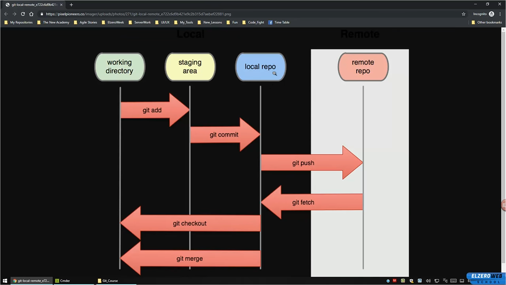

# Git/Githup Workshoop/ First OMC IT Workshoop

** Learn git/github: A discord meeting **

## What we Learned

### git basic commands

**
git init
git clone
git add
git commit -m ""
git push
**

### git files

**
.git file
gitignore file
readme.md file
**

### git stages

#### working directory

**
the stage that the the work is only on the directory folder.
**

#### staging area

**
The stage that the work in an isolate phase before commit to the local repo.
**

#### local repo

**
The main repo that all the work on the device and not publish it or push it in a cloud repo (remote repo).
**

#### remote repo

\*\*
Briefly, Is the Github repo (the cloud repo that everyone every developer can see share contribute redistribute.....etc the code.)

